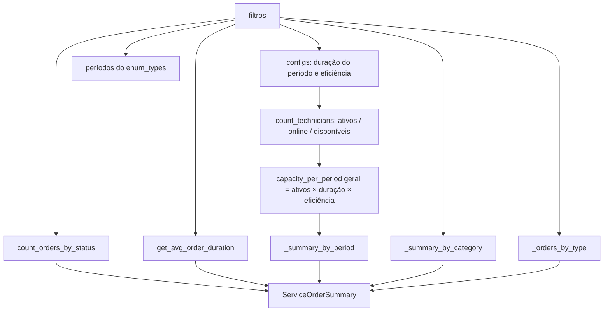

# Resumo de Agendamento (`SchedulingService.get_summary`)

Documento técnico de como o **resumo de agendamento** de ordens de serviço é calculado: de onde
vêm os números, como técnicos, categorias e capacidades entram na conta, quais variáveis e
configurações existem e quais são os comportamentos não óbvios.

| Item | Onde |
|---|---|
| Endpoint | `GET /api/core/v1/service-orders/scheduling/summary` |
| Permissão | `PermissionEnum.SERVICE_ORDER_READ` |
| Controller | `app/api/v1/service_order/service_orders_controller.py` (`get_service_orders_scheduling_summary`) |
| Service | `app/services/scheduling/scheduling_service.py` (`SchedulingService.get_summary`) |
| Queries | `app/repositories/scheduling/scheduling_repository.py` (`SchedulingRepository`) |
| Schemas | `app/schemas/service_order/service_orders_schema.py` (`ServiceOrderSummary*`) |

---

## 1. Ideia geral

O resumo responde três perguntas sobre **um dia** de agenda:

1. **Quantas OS existem nesse dia e em que situação estão?** (contagem por status e por tipo, tempo médio)
2. **Quantos técnicos existem e quantos estão conectados/disponíveis agora?**
3. **Quanto da capacidade da equipe já está ocupada?** No dia inteiro, por período (manhã/tarde)
   e por categoria de OS.

A ocupação é sempre a mesma razão:

```
ocupação (%) = horas consumidas / horas de capacidade × 100   (com teto de 100%)
```

- **Capacidade** = quantas horas de trabalho os técnicos conseguem entregar num período.
- **Consumo** = soma do **SLA** (tempo previsto, em horas) das OS **ativas** agendadas para o período.

> O consumo usa o **SLA da categoria**, não o tempo real gasto. Uma OS de "Instalação" com SLA
> de 1,5 h consome 1,5 h da agenda, não importa quanto ela realmente demorou.

---

## 2. Entrada: filtros (`ServiceOrderSummaryFilters`)

Query params (camelCase na API):

| Param | Tipo | Default | Efeito |
|---|---|---|---|
| `scheduledDate` | `date` | `date.today()` | Dia analisado. Todas as OS são filtradas por `scheduled_date == scheduledDate`. |
| `type` | `list[ServiceOrderTypeEnum]` | `None` (todos) | Filtra as OS pelo tipo (`installation`, `maintenance`, `infra`, `audit`, ...). |
| `categoryIds` | `list[UUID]` | `None` (todas) | Filtra as OS pela categoria. |

> ⚠️ Os filtros afetam **as OS** (contagens e consumo). Eles **não** filtram os técnicos do
> resumo geral — ver §9.1.

---

## 3. Variáveis e configurações

### 3.1 Configurações da tabela `config` (`ConfigTableService`)

| `ConfigEnum` | Chave no banco | Default | Significado |
|---|---|---|---|
| `SCHEDULE_PERIOD_DURATION_HOURS` | `schedule-period-duration-hours` | `4.0` | Duração de um período (manhã ou tarde), em horas. |
| `SCHEDULE_PERIOD_EFFICIENCY` | `schedule-period-efficiency` | `0.8` | Fração do período que vira trabalho produtivo (desconta deslocamento, pausas, imprevistos). |

Com os defaults, **cada técnico entrega `4 × 0,8 = 3,2 h` por período**.

### 3.2 Períodos (tabela `enum_types`)

Os períodos vêm de `EnumTypeService.get_by_type(EnumTypeEnum.SERVICE_ORDERS_PERIODS)[0].children`.
Hoje: `morning` (Manhã) e `afternoon` (Tarde). A **ordem e a quantidade** de períodos da resposta
seguem esse cadastro. Se um período novo for cadastrado, ele entra automaticamente na conta
(inclusive multiplicando a capacidade diária por categoria, ver §6).

### 3.3 Variáveis internas do cálculo

| Variável | Fórmula / origem | Usada em |
|---|---|---|
| `scheduled_date` | `filters.scheduled_date or date.today()` | todas as queries |
| `period_duration` | config `SCHEDULE_PERIOD_DURATION_HOURS` | capacidade |
| `efficiency` | config `SCHEDULE_PERIOD_EFFICIENCY` | capacidade |
| `period_keys` | filhos do enum `service_orders_periods` | grade de períodos |
| `active_technicians` | técnicos ativos (todos) | resumo geral |
| `capacity_per_period` (geral) | `active_technicians × period_duration × efficiency` | `periods[]` |
| `active_technician_ids` (categoria) | técnicos ativos com capacidade **nesta** categoria | `categories[]` |
| `capacity_per_period` (categoria) | `len(active_technician_ids) × period_duration × efficiency` | `categories[].periods[]` |
| `periods_quantity` | `max(len(period_keys), 1)` | capacidade diária da categoria |
| `capacity_hours` (categoria) | `capacity_per_period × periods_quantity` | `categories[]` |
| `shared_category_ids` | todas as categorias que os técnicos da categoria atendem | consumo da categoria |
| `consumed_hours` | `SUM(service_order_categories.sla)` das OS ativas | ocupação |

### 3.4 Conjuntos de status (`app/dependencies/constants.py`)

| Conjunto | Status |
|---|---|
| `ACTIVE_STATUSES` | `scheduled`, `rescheduled`, `in_motion`, `arrived`, `difficulty`, `products_used`, `checklist`, `resolution`, `provision`, `syncing`, `unproductive_checklist`, `pending_approval` |
| `SCHEDULED_STATUSES` | `scheduled`, `rescheduled` |
| `IN_PROGRESS_STATUSES` | `ACTIVE_STATUSES − SCHEDULED_STATUSES` |
| Fora de `ACTIVE_STATUSES` | `pending`, `completed`, `closed`, `unproductive`, `expired` |

**Só OS em `ACTIVE_STATUSES` consomem capacidade.** OS concluídas, fechadas, improdutivas ou
expiradas já liberaram a agenda.

---

## 4. Técnicos: ativo, online e disponível

Definições em `SchedulingRepository` (`_active_technician_filters`, `_online_technician_filters`,
`_available_technician_filters`):

| Estado | Regra |
|---|---|
| **Ativo** | `role = technician`, `status = active`, `deleted_at IS NULL` |
| **Online** | ativo **e** `online_at` nos últimos **5 min** **e** `last_location_at` nos últimos **10 min** |
| **Disponível** | online **e** `is_available = true` |

- No resumo geral (`count_technicians`) os três números saem numa única query, com
  `COUNT(DISTINCT id) FILTER (WHERE ...)`.
- Por categoria (`count_technicians_by_category`) saem `active` e `online` agrupados pela
  categoria da capacidade do técnico.

> "Online" e "disponível" são **o momento atual** (`now()`), não o dia consultado. Consultando
> um dia passado ou futuro, esses números continuam sendo os de agora.

### 4.1 Capacidade do técnico (`technician_capacities`)

A tabela `technician_capacities` liga **técnico ↔ categoria de OS** (`technician_id`,
`service_order_category_id`, `proficiency`, `deleted_at`). É ela que define **quais categorias
cada técnico atende**.

- Uma linha = "o técnico X atende a categoria C".
- Um técnico pode ter várias linhas (atende várias categorias).
- A `proficiency` **não** entra no cálculo: todo técnico vale o mesmo `period_duration × efficiency`.
- Linhas com `deleted_at` preenchido são ignoradas.

---

## 5. Montagem da resposta, passo a passo



### 5.1 Contagens por status — `count_orders_by_status`

```sql
SELECT status, COUNT(id)
FROM service_orders
WHERE deleted_at IS NULL
  AND scheduled_date = :scheduled_date
  [AND type IN (:types)]
  [AND category_id IN (:category_ids)]
GROUP BY status
```

**Sem filtro de status**: conta TODAS as OS do dia. A partir do dicionário `{status: total}`:

| Campo da resposta | Cálculo |
|---|---|
| `totalOrders` | soma de todos os status |
| `scheduledOrders` | `scheduled` |
| `rescheduledOrders` | `rescheduled` |
| `inProgressOrders` | soma de `IN_PROGRESS_STATUSES` |
| `completedOrders` | `completed` |
| `closedOrders` | `closed` |
| `unproductiveOrders` | `unproductive` |
| `pendingOrders` | `pending` |
| `pendingApprovalOrders` | `pending_approval` |

### 5.2 Tempo médio — `get_avg_order_duration`

`AVG(duration_in_minutes)` de **todas** as OS do dia (qualquer status) com
`duration_in_minutes IS NOT NULL`, mesmos filtros de tipo/categoria. Arredondado a 2 casas.
Sem dados → `0.0`. Campo: `avgOrderTimeInMinutes`.

### 5.3 Técnicos — `count_technicians`

`activeTechnicians`, `onlineTechnicians`, `availableTechnicians` (regras do §4). Sem filtro de
categoria/tipo.

### 5.4 OS por tipo — `_orders_by_type`

`COUNT(id) GROUP BY type` de todas as OS do dia, ordenado do maior para o menor. Para cada linha:

- `key` = tipo (`installation`, ...)
- `label` = `get_service_order_type_label(key)` (ex.: "Instalação"); tipo nulo → `"Não informado"`
- `count` = quantidade
- `percentage` = `count / total × 100`, 1 casa decimal (`total` = soma das linhas)

### 5.5 Ocupação geral por período — `_summary_by_period`

**Capacidade** (igual para todos os períodos):

```
capacity_per_period = active_technicians × period_duration × efficiency
```

**Consumo** (`summarize_orders_by_period`):

```sql
SELECT so.period, COUNT(so.id) AS scheduled, COALESCE(SUM(cat.sla), 0) AS consumed_hours
FROM service_orders so
JOIN service_order_categories cat ON cat.id = so.category_id
WHERE so.deleted_at IS NULL
  AND so.status IN (ACTIVE_STATUSES)
  AND so.scheduled_date = :scheduled_date
  [AND so.type IN (:types)]
  [AND so.category_id IN (:category_ids)]
GROUP BY so.period
```

Para cada período de `period_keys` (período sem OS vem zerado):

| Campo | Valor |
|---|---|
| `period` | chave do período |
| `scheduled` | nº de OS ativas no período |
| `consumedHours` | soma dos SLAs |
| `capacityHours` | `capacity_per_period` |
| `periodOccupation` | `min(consumed / capacity × 100, 100)` (0 se capacidade ≤ 0) |

OS com `period` nulo ou com um período que não está no enum ficam fora de `periods[]`.

### 5.6 Ocupação por categoria — `_summary_by_category`

É a parte mais elaborada. Parte do princípio de que **o técnico tem uma agenda só**: se ele atende
Instalação e Manutenção, uma hora gasta em Manutenção é uma hora a menos para Instalação.

**1) Quais categorias aparecem.** `summarize_orders_by_category_and_period` agrupa as OS ativas
do dia por `(categoria, período)`, com os filtros de tipo/categoria. **Só aparecem categorias que
têm pelo menos uma OS ativa no dia.**

**2) Para cada categoria C:**

```
active_technician_ids = técnicos ativos com capacidade em C
capacity_per_period   = len(active_technician_ids) × period_duration × efficiency
capacity_hours        = capacity_per_period × periods_quantity

shared_category_ids   = todas as categorias que esses técnicos atendem (inclui C)
                        ∩ categoryIds do filtro (se houver filtro)

consumo por período   = SUM(sla) das OS ativas do dia
                        cujas categorias estão em shared_category_ids
                        (e com o filtro de tipo aplicado)
```

Ou seja:

- **Capacidade** é só dos técnicos que atendem **C**. Técnico de outra categoria não infla a
  capacidade de C.
- **Consumo** é de **todas as categorias compartilhadas** pelos técnicos de C, porque disputam a
  mesma agenda.
- **Contagem (`scheduled`, `totalOrders`)** é só das OS **da própria categoria C**.
  Por isso `consumedHours` pode ser maior que `totalOrders × categorySla`.

**3) Campos da categoria:**

| Campo | Valor |
|---|---|
| `categoryId`, `categoryName`, `categorySla` | dados da categoria |
| `totalOrders` | OS ativas de C no dia |
| `activeTechnicians`, `onlineTechnicians` | técnicos com capacidade em C (§4) |
| `capacityHours` | `capacity_per_period × periods_quantity` (capacidade do dia) |
| `consumedHours` | soma do consumo compartilhado de todos os períodos |
| `occupationPercentage` | `min(consumed / capacity × 100, 100)` |
| `periods[]` | `period`, `scheduled` (só C), `consumedHours` (compartilhado), `capacityHours` (`capacity_per_period`), `occupationPercentage` |

---

## 6. Exemplo completo

**Configuração:** `period_duration = 4`, `efficiency = 0,8`, ou seja **3,2 h por técnico por período**.
Períodos: manhã e tarde.

**Categorias:**

| Categoria | SLA |
|---|---|
| Instalação | 1,5 h |
| Manutenção | 1,0 h |
| Infra | 2,0 h |

**Técnicos (ativos) e capacidades (`technician_capacities`):**

| Técnico | Atende |
|---|---|
| X | Instalação, Manutenção |
| Y | Instalação |
| Z | Infra |

**OS ativas do dia:**

| Período | Instalação | Manutenção | Infra |
|---|---|---|---|
| Manhã | 3 | 1 | 1 |
| Tarde | 1 | 2 | 0 |

### 6.1 Geral (`periods[]`)

`capacity_per_period = 3 técnicos × 3,2 = 9,6 h`

| Período | scheduled | consumedHours | capacityHours | periodOccupation |
|---|---|---|---|---|
| Manhã | 5 | 3×1,5 + 1×1,0 + 1×2,0 = **7,5** | 9,6 | 7,5 / 9,6 = **78,13%** |
| Tarde | 3 | 1×1,5 + 2×1,0 = **3,5** | 9,6 | 3,5 / 9,6 = **36,46%** |

### 6.2 Instalação

- Técnicos: X, Y, então `capacity_per_period = 2 × 3,2 = 6,4 h` e `capacity_hours = 6,4 × 2 = 12,8 h`
- `shared_category_ids` = {Instalação, Manutenção} (X atende as duas)

| Período | scheduled (só Instalação) | consumedHours (Inst. + Manut.) | capacity | ocupação |
|---|---|---|---|---|
| Manhã | 3 | 4,5 + 1,0 = 5,5 | 6,4 | 85,94% |
| Tarde | 1 | 1,5 + 2,0 = 3,5 | 6,4 | 54,69% |
| **Dia** | **4** | **9,0** | **12,8** | **70,31%** |

### 6.3 Manutenção

- Técnicos: só X, então `capacity_per_period = 3,2 h` e `capacity_hours = 6,4 h`
- `shared_category_ids` = {Instalação, Manutenção}, ou seja, as categorias de X

| Período | scheduled (só Manut.) | consumedHours | capacity | ocupação |
|---|---|---|---|---|
| Manhã | 1 | 5,5 | 3,2 | 171,9%, limitado a **100%** |
| Tarde | 2 | 3,5 | 3,2 | 109,4%, limitado a **100%** |
| **Dia** | **3** | **9,0** | **6,4** | **100%** |

> Repare: as instalações de Y entram no consumo de Manutenção porque Instalação é uma categoria
> compartilhada por X. É uma visão **conservadora**: assume que qualquer OS de uma categoria
> compartilhada pode cair na agenda dos técnicos de C (ver §9.3).

### 6.4 Infra

- Técnicos: Z, então `capacity_per_period = 3,2 h` e `capacity_hours = 6,4 h`
- `shared_category_ids` = {Infra}

| Período | scheduled | consumedHours | ocupação |
|---|---|---|---|
| Manhã | 1 | 2,0 | 62,5% |
| Tarde | 0 | 0,0 | 0% |
| **Dia** | **1** | **2,0** | **31,25%** |

---

## 7. Formato da resposta

```json
{
  "totalOrders": 8,
  "scheduledOrders": 6,
  "rescheduledOrders": 0,
  "inProgressOrders": 2,
  "completedOrders": 0,
  "closedOrders": 0,
  "unproductiveOrders": 0,
  "pendingOrders": 0,
  "pendingApprovalOrders": 0,
  "avgOrderTimeInMinutes": 72.5,
  "activeTechnicians": 3,
  "onlineTechnicians": 2,
  "availableTechnicians": 1,
  "periods": [
    { "period": "morning", "scheduled": 5, "consumedHours": 7.5, "capacityHours": 9.6, "periodOccupation": 78.13 },
    { "period": "afternoon", "scheduled": 3, "consumedHours": 3.5, "capacityHours": 9.6, "periodOccupation": 36.46 }
  ],
  "categories": [
    {
      "categoryId": "…",
      "categoryName": "Instalação",
      "categorySla": 1.5,
      "totalOrders": 4,
      "activeTechnicians": 2,
      "onlineTechnicians": 1,
      "capacityHours": 12.8,
      "consumedHours": 9.0,
      "occupationPercentage": 70.31,
      "periods": [
        { "period": "morning", "scheduled": 3, "consumedHours": 5.5, "capacityHours": 6.4, "occupationPercentage": 85.94 },
        { "period": "afternoon", "scheduled": 1, "consumedHours": 3.5, "capacityHours": 6.4, "occupationPercentage": 54.69 }
      ]
    }
  ],
  "ordersByType": [
    { "key": "installation", "label": "Instalação", "count": 4, "percentage": 50.0 }
  ]
}
```

Arredondamentos: horas e ocupação com 2 casas, `percentage` de `ordersByType` com 1 casa.

---

## 8. Relação com `get_available_dates`

O mesmo modelo de capacidade alimenta a grade de **datas disponíveis para agendamento**
(`get_available_dates`), garantindo que o que o resumo mostra bate com o que o cliente consegue
agendar:

| Aspecto | `get_summary` | `get_available_dates` |
|---|---|---|
| Capacidade da categoria | técnicos de C × duração × eficiência | igual |
| Consumo | categorias compartilhadas | igual |
| Status que consomem | `ACTIVE_STATUSES` | igual |
| Infra/Audit | contam no consumo | contam no consumo; a própria categoria infra/audit libera todos os dias |
| Feriados | **não** considera | feriado geral bloqueia o dia; feriado de equipe tira os técnicos de folga da capacidade |
| Fim de semana | não considera | domingo e sábado à tarde dependem de `WEEKEND_SCHEDULING_ENABLED` |
| Horário limite do dia atual | não considera | `MORNING/AFTERNOON_PERIOD_SCHEDULING_LIMIT_TIME` |
| Critério de vaga | mostra ocupação (%) | só libera se `consumido + SLA ≤ capacidade` (cabe uma OS inteira) |

---

## 9. Comportamentos não óbvios e pontos de atenção

### 9.1 Filtros afetam o consumo, mas não a capacidade geral
Em `periods[]`, `capacity_per_period` usa **todos** os técnicos ativos, enquanto o consumo respeita
`type`/`categoryIds`. Filtrando só "Instalação", a capacidade continua sendo a da equipe inteira e a
ocupação tende a parecer mais baixa do que a real para aquela categoria. Para olhar uma categoria
específica, a fonte certa é `categories[]`.

### 9.2 Contagens e consumo usam recortes de status diferentes
- `totalOrders`, contagens por status, `ordersByType` e `avgOrderTimeInMinutes`: **todas** as OS do dia.
- `periods[]` e `categories[]`: só OS **ativas**.

Consequência: ao longo do dia, conforme as OS vão sendo concluídas, a ocupação **cai** (elas
deixam de consumir), mesmo que o total de OS do dia não mude.

### 9.3 Consumo compartilhado é pessimista
O consumo da categoria C soma as OS de **todas** as categorias atendidas pelos técnicos de C,
inclusive OS atendidas por técnicos que não atendem C (exemplo do §6.3: as instalações de Y entram
na ocupação de Manutenção). Isso evita liberar agenda que talvez não exista, mas pode mostrar
categorias "lotadas" quando ainda há folga.

### 9.4 `pending_approval` conta duas vezes
`IN_PROGRESS_STATUSES = ACTIVE_STATUSES − SCHEDULED_STATUSES` inclui `pending_approval`. Uma OS
nesse status aparece em `inProgressOrders` **e** em `pendingApprovalOrders`. Já `expired` não tem
campo próprio, mas entra em `totalOrders`. Por isso a soma dos campos de status pode não fechar
com `totalOrders`.

### 9.5 `pendingOrders` costuma ser baixo
OS `pending` normalmente não têm data. Como tudo é filtrado por `scheduled_date`, só entram as
pendentes que por algum motivo têm data preenchida.

### 9.6 Categoria sem OS não aparece
`categories[]` é montado a partir das OS ativas do dia. Uma categoria com técnicos disponíveis mas
sem nenhuma OS não aparece na lista (sua ocupação seria 0%).

### 9.7 Teto de 100%
`_occupation` limita o resultado a 100%. Sobrecarga (ex.: 171%) não é exposta, então "100%" quer
dizer "cheio ou acima da capacidade". Capacidade 0 (nenhum técnico) resulta em `0%`, não em erro.

### 9.8 SLA, não duração real
O consumo usa `service_order_categories.sla` (horas). `duration_in_minutes` (duração real) só entra
no `avgOrderTimeInMinutes`.

### 9.9 "Online"/"disponível" são do momento atual
Calculados com `now()`, independentes de `scheduledDate`.

### 9.10 Data padrão sem fuso
`date.today()` usa o fuso do servidor. Em container UTC, entre 21h e 0h (horário de Brasília) o
default já é o dia seguinte. O front deve sempre enviar `scheduledDate`.

### 9.11 Proficiência e feriados não entram
Todo técnico vale a mesma capacidade, independente da `proficiency`. Feriados/folgas de equipe são
considerados só na grade de datas disponíveis.

---

## 10. Custo de queries

| Etapa | Queries |
|---|---|
| Configs + enum de períodos | 2 (podem estar em cache) |
| `count_technicians` | 1 |
| `count_orders_by_status` | 1 |
| `get_avg_order_duration` | 1 |
| `_summary_by_period` | 1 |
| `_summary_by_category` (base + técnicos por categoria) | 2 |
| `_summary_by_category`, **por categoria** | até 3 (técnicos da categoria, categorias compartilhadas, consumo) |
| `_orders_by_type` | 1 |

Total aproximado: **~9 + 3 × (nº de categorias com OS no dia)**. O endpoint não tem cache.

---

## 11. Testes de referência

- `tests/endpoints/scheduling/test_scheduling.py`: resumo com OS, dia vazio, `ordersByType`,
  filtros por tipo/categoria.
- `tests/endpoints/scheduling/test_scheduling_shared_team_capacity.py`: capacidade restrita aos
  técnicos da categoria, consumo compartilhado, teto de 100% e consistência com
  `get_available_dates`.
